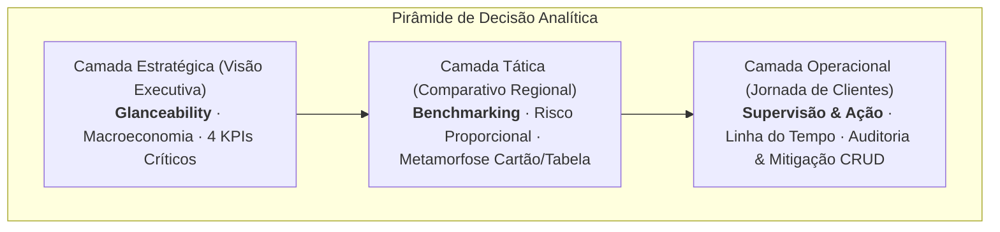
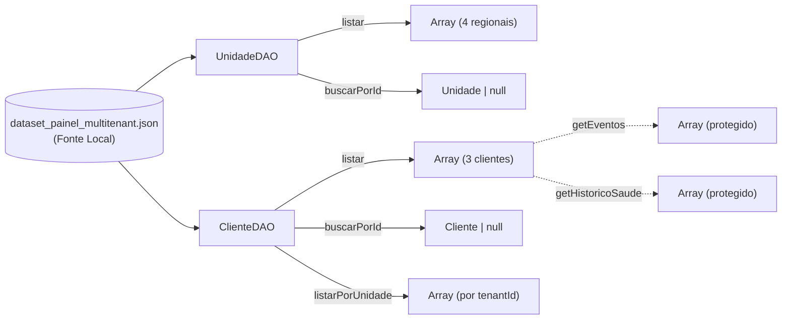
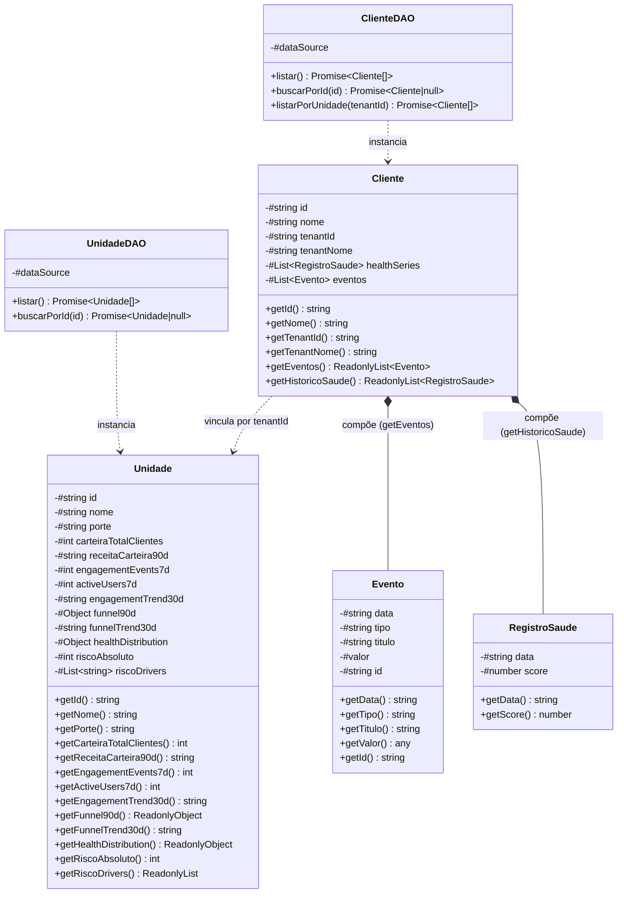

# Painel de Inteligência Multi-tenant — Distribuidora Vetor

> **Projeto Integrador — Bolsa Futuro Digital**  
> **Desafio 2:** Painel de Inteligência Multi-tenant em ReactJS e Ant Design (AntD)  
> **Status:** Protótipo Acadêmico Funcional com Dados Fictícios

---

## 📌 1. Visão Geral do Projeto

A **Distribuidora Vetor** opera em diferentes unidades regionais (*tenants*) que possuem carteiras de clientes de portes bastante variados. Este painel foi desenvolvido para atender às seguintes necessidades de negócio:

1. **Visão Gerencial Unificada:** Acompanhamento de indicadores de engajamento, funil comercial de tarefas e distribuição de saúde da carteira de clientes.
2. **Comparativo Justo entre Unidades:** Avaliação de desempenho e criticidade normalizada por porte, evitando a distorção gerada por comparações puramente absolutas.
3. **Acompanhamento da Jornada do Cliente:** Consulta cronológica de eventos com diferenciação visual e monitoramento da evolução do score de saúde.

---

## 🛠️ 2. Tecnologias Utilizadas

- **Framework:** [ReactJS](https://react.dev/) (v18) com [Vite](https://vitejs.dev/)
- **Biblioteca Visual (Obrigatória):** [Ant Design](https://ant.design/) (v5) e `@ant-design/icons`
- **Visualização de Dados (Gráficos):** [Recharts](https://recharts.org/)
- **Manipulação de Datas:** [Day.js](https://day.js.org/)
- **Fonte de Dados:** `dataset_painel_multitenant.json` local (conforme escopo acadêmico)

---

## 🚀 3. Instalação e Execução Local

### Pré-requisitos
- **Node.js** (versão 18 ou superior recomendada)
- **npm** (versão 9 ou superior)

### Passo a Passo

1. **Instalar dependências:**
   ```bash
   npm install
   ```

2. **Executar em ambiente de desenvolvimento:**
   ```bash
   npm run dev
   ```
   A aplicação estará acessível em: `http://localhost:5173`

3. **Executar a suíte de testes (Sprint 5 — POO & DAOs + Métricas):**
   ```bash
   npm test
   ```
   *(Executa 56 asserções de integridade, atributos privados, imutabilidade e consultas aos DAOs)*

4. **Gerar build de produção:**
   ```bash
   npm run build
   ```

---

## 📱 4. Descrição das Telas e Componentes Implementados (Sprint 2)

### 🧩 Componentes React Reutilizáveis
- **`UnidadeCard.jsx` (Componente de Unidade com Props):**
  - Implementado para apresentar os cartões das quatro unidades do dataset (`Unidade Sudeste`, `Unidade Sul`, `Unidade Nordeste`, `Unidade Centro-Oeste`).
  - Recebe os dados da unidade via props (`unidade`, `isSelected`, `onSelect`, `themeTokens`).
  - Utiliza os componentes Ant Design: `<Card>`, `<Statistic>` (Carteira, Engajamento, Funil), `<Tag>` (Porte, Status de Risco, "Dado Fictício"), `<Typography>`, `<Row>` e `<Col>`.
  - Suporta seleção interativa com foco de teclado (`Enter`/`Espaço`) e navegação acessível.

### Tela 1 — Visão Geral (Sprint 2)
- **Cards de Indicadores Executivos (Ant Design):** Total de clientes na carteira, taxa proporcional de risco, conversão do funil de 90 dias e engajamento médio implementados com `<Card>`, `<Statistic>`, `<Tag>` e `<Row/Col>`.
- **Grade das Quatro Unidades Regionais:** Grid de `<Row gutter={[16, 16]}>` com os componentes reutilizáveis `<UnidadeCard />` apresentando nome, porte, carteira, engajamento e funil com dados estáticos do dataset.
- **Funil Comercial e Distribuição de Saúde:** Painel analítico de conversão com indicadores e gráficos informativos.
- **Identificação do Protótipo:** Banner e tags visuais indicando explicitamente dados estáticos e fictícios.

### Tela 2 — Comparativo entre Unidades (Sprint 2)
- **Tabela Comparativa Ant Design (`<Table>`):** Estrutura de tabela completa com unidades, carteira total, taxas ilustrativas, ordenação dinâmica (`sorters`) e filtros por porte.
- **Ranking de Criticidade e Espaço para Gráficos:** Classificação por criticidade e gráficos comparativos de barras e linha dupla ilustrando volumes absolutos vs. taxas proporcionais.

### Tela 3 — Histórico e Gestão de Clientes (CRUD Completo)
- **Operações de CRUD Integradas (Create, Read, Update, Delete):**
  - **Create (Adicionar):** Modal com formulário reativo para cadastrar novas contas B2B vinculadas a uma regional, com definição de segmento, tempo de contrato, ticket médio e score inicial.
  - **Read (Leitura):** Seletor em abas de todas as contas da carteira, ficha cadastral completa com ticket médio, tempo de contrato, variação semestral e gráfico de score.
  - **Update (Editar):** Modal de edição pré-populado para alterar dados cadastrais, porte, regional vinculada e score de saúde com registro automático de auditoria na timeline.
  - **Delete (Excluir):** Exclusão assistida com `<Popconfirm>` de confirmação do Ant Design, feedback imediato e seleção automática da próxima conta disponível.
- **Linha do Tempo Oficial Ant Design (`<Timeline>`):** Implementação via `<Timeline items={...} />` do Ant Design v5 com diferenciação visual por cores (`green`, `red`, `orange`, `cyan`) e ícones temáticos para cada categoria (*Sucesso*, *Crítico*, *Alerta*, *Comercial*), com data e descrição detalhada.
- **Persistência de Dados Local:** Armazenamento automático via `localStorage` garantindo que novos cadastros, edições e remoções permaneçam salvos entre recarregamentos de página.

---

## 📐 5. Justificativas Teóricas e de UX

### 5.1 Critério do Indicador Comparativo Proporcional (RF05 & RF06)

* **Fórmula Adotada:**
  $$\text{Taxa de Risco Proporcional} = \frac{\text{Clientes em Risco} + \text{Clientes Críticos}}{\text{Carteira Total de Clientes}} \times 100$$
* **Por que normalizar por porte?**  
  Em valores absolutos, a **Unidade Sudeste (Matriz)** possui 100 clientes em risco (o maior número absoluto). Contudo, sobre uma base de 1.200 clientes, isso representa apenas **8,33%**. Por outro lado, a **Unidade Centro-Oeste** possui apenas 35 clientes em risco, mas sobre uma base de 150 clientes, isso representa **23,33%** da carteira. Sem normalização proporcional, a gestão focaria recursos na Matriz e ignoraria a fragilidade crítica do Centro-Oeste.
* **Limites da Fórmula:**  
  A fórmula adota pesos iguais para as categorias "Risco" e "Crítico" e não pondera a receita financeira (ticket médio) individual de cada contrato. Em uma evolução futura, recomenda-se ponderar pela receita sob risco.

### 5.2 Justificativa: Quando usar Gráfico vs. Tabela? (RF09)

| Formato | Quando é mais indicado | Exemplo no Painel |
| :--- | :--- | :--- |
| **Gráfico** | Ideal para identificar rapidamente contrastes de proporção, anomalias e tendências temporais sem sobrecarga cognitiva. | O gráfico composto da Tela 2 expõe de relance como o volume da Matriz mascara sua baixa taxa de risco proporcional. |
| **Tabela** | Essencial quando o usuário precisa consultar valores numéricos exatos, realizar comparações detalhadas, ordenar dados por colunas específicas e filtrar categorias. | A tabela comparativa da Tela 2 permite ordenar as unidades por qualquer indicador e filtrar por porte para auditoria. |

---

## 📂 6. Estrutura de Pastas do Código

```
Desafio-Primora/
├── index.html
├── package.json
├── vite.config.js
├── test-metrics.js                           # Suite de testes de validação das fórmulas
├── README.md
└── src/
    ├── main.jsx                              # Ponto de entrada React 18
    ├── App.jsx                               # Shell da aplicação com ConfigProvider Ant Design
    ├── data/
    │   └── dataset_painel_multitenant.json   # Dataset oficial com 4 tenants e 3 clientes
    ├── utils/
    │   ├── metrics.js                        # Funções de cálculo estatístico e formatação
    │   └── themeTokens.js                    # Design tokens Dark/Light e semântica de risco
    ├── components/
    │   ├── UnidadeCard.jsx                   # Componente reutilizável com AntD Card, Statistic e Tag
    │   ├── TopBar.jsx                        # Barra de navegação entre as 3 telas e alternador de tema
    │   ├── AcademicBanner.jsx                # Banner identificador de protótipo acadêmico
    │   ├── FlatFunnelHealth.jsx              # Componente de funil e saúde da carteira
    │   └── componentsCSS/                    # Folhas de estilo modularizadas
    └── pages/
        ├── VisaoGeral.jsx                    # Tela 1: Indicadores consolidados e Grid de UnidadeCard
        ├── Comparativo.jsx                   # Tela 2: Tabela Ant Design e Gráficos Comparativos
        └── HistoricoClientes.jsx             # Tela 3: Ficha de Cliente e Timeline Ant Design
```

---

## 🏛️ 6. Arquitetura de Dashboards Modulares: Responsividade Contextual e Customização Executiva

O projeto adota os pilares da moderna engenharia de front-end para dashboards de alto desempenho analítico, transpondo a visão tradicional de responsividade mecânica para uma **Responsividade Contextual e Cognitiva**:



### 6.1. Responsividade Contextual vs. Responsividade Mecânica
- **Glanceability (Vislumbre Imediato):** Telas executivas otimizadas para compreensão visual em menos de 5 segundos, reduzindo a sobrecarga cognitiva e respeitando a **Lei de Hick**.
- **Data-Ink Ratio (Edward Tufte):** Maximização da proporção tinta/dados através da eliminação de elementos puramente decorativos e da "poeira decimal" (arredondamento estratégico de valores com suporte a tipografia monotípica `tabular-nums`).
- **Ergonomia e Thumb Zone (WCAG 2.2):** Botões de ação rápida e barra de navegação inferior (*Bottom Navigation*) respeitam a zona natural do polegar em dispositivos móveis, garantindo alvos de toque com dimensão mínima de 48×48px.

### 6.2. Metamorfose Estrutural com CSS Container Queries
A tabela de comparativo regional implementa **CSS Container Queries** (`container-type: inline-size; container-name: tableContainer`). Diferente de media queries globais (`@media (max-width)`), o componente reage à largura útil do seu próprio elemento pai, permitindo funcionamento perfeito em painéis divididos (*split-screen*), sidebars recolhíveis e janelas compactas sem quebra de números ou sobreposição visual.

### 6.3. Persistência Híbrida em Duas Camadas
- **Hidratação Síncrona:** Leitura direta do `localStorage` no carregamento da árvore React, eliminando completamente piscadas e Cumulative Layout Shift (CLS).
- **Sincronização Inter-Abas:** Escuta ativa do evento global `window.addEventListener('storage')`, permitindo que mutações na carteira de clientes realizadas em uma aba reflitam instantaneamente nas demais abas abertas.

---

## 🏛️ 7. Sprint 5 — Modelagem de Domínio, Encapsulamento e DAOs

> **Etapa:** Sprint 5 de 7 | **Projeto Integrador — Bolsa Futuro Digital**  
> **Tema:** Organização da camada de dados com Programação Orientada a Objetos (POO), Atributos Privados (`#`), Encapsulamento Defensivo e Padrão Data Access Object (DAO) com Consultas Assíncronas (`async/Promise`).

### 7.1. Esclarecimento sobre o Contrato Pedagógico de DAOs
> [!IMPORTANT]
> **Aviso Acadêmico:** O contrato pedagógico de DAOs aqui implementado **não constitui API REST ou contrato HTTP oficial da Primora**. A empresa parceira disponibilizou o dataset em arquivo JSON local (`dataset_painel_multitenant.json`). Os métodos dos DAOs foram estabelecidos pedagogicamente para estruturar e desacoplar o acesso a dados no frontend em conformidade com as boas práticas de engenharia de software, preparando a aplicação para a futura integração com serviços de backend na Sprint 6 sem quebrar a continuidade das telas existentes.

---

### 7.2. Classes de Domínio Implementadas (`src/models/`)

Todas as classes foram implementadas utilizando atributos estritamente privados do padrão ECMAScript (`#propriedade`), acessíveis apenas internamente na instância. Métodos de acesso (*getters*) expõem as leituras e protegem coleções internas contra mutações externas indevidas (`Object.freeze` e cópias defensivas):

| Classe | Arquivo | Responsabilidades e Atributos Obrigatórios | Validações e Encapsulamento |
| :--- | :--- | :--- | :--- |
| **`Unidade`** | `src/models/Unidade.js` | Modela a regional (*tenant*). Possui 13 atributos obrigatórios: `id`, `nome`, `porte`, `carteiraTotalClientes`, `receitaCarteira90d`, `engagementEvents7d`, `activeUsers7d`, `engagementTrend30d`, `funnel90d`, `funnelTrend30d`, `healthDistribution`, `riscoAbsoluto` e `riscoDrivers`. | Atributos privados `#`. Validação de ID e nome obrigatórios, carteira $\ge 0$. Retorno de `funnel90d`, `healthDistribution` e `riscoDrivers` protegidos com `Object.freeze` contra mutações acidentais. |
| **`Cliente`** | `src/models/Cliente.js` | Modela a conta B2B atendida por uma unidade: `id`, `nome`, `tenantId`, `tenantNome`, `healthSeries` e `eventos`. Preserva o vínculo regional via `tenantId`. | Atributos privados `#`. Converte itens de saúde e eventos em instâncias de `RegistroSaude` e `Evento`. Fornece métodos `getEventos()` e `getHistoricoSaude()` com retorno de coleções congeladas/imutáveis. |
| **`Evento`** | `src/models/Evento.js` | Modela interações na jornada do cliente: `data`, `tipo`, `titulo` e `valor` (opcional). | Atributos privados `#`. **Não exige `id` obrigatório** ausente do dataset (atende estritamente à regra pedagógica). Validação de data e tipo não vazios. |
| **`RegistroSaude`** | `src/models/RegistroSaude.js` | Modela ponto na série histórica de saúde (*healthSeries*): `data` e `score`. | Atributos privados `#`. Validação de presença da data e restrição de score na faixa numérica de 0 a 100. |

---

### 7.3. Camada DAO e Contrato de Consulta Assíncrona (`src/dao/`)

Os DAOs centralizam todas as operações de leitura dos dados, retornando sempre `Promises` resolvidas com instâncias legítimas das classes de domínio:



#### Contrato dos Métodos Implementados:
1. **`UnidadeDAO.listar()`:**
   - **Retorno:** `Promise<Unidade[]>`
   - **Resultado no dataset:** Recupera as **4 unidades regionais** (`tenant-sudeste`, `tenant-sul`, `tenant-nordeste`, `tenant-centro-oeste`), cada uma convertida em objeto da classe `Unidade`.
2. **`UnidadeDAO.buscarPorId(id)`:**
   - **Retorno:** `Promise<Unidade | null>`
   - **Resultado:** Retorna a instância correspondente (ex: `tenant-sudeste`) ou `null` caso o ID não exista.
3. **`ClienteDAO.listar()`:**
   - **Retorno:** `Promise<Cliente[]>`
   - **Resultado no dataset:** Recupera os **3 clientes B2B** (`CLI-001`, `CLI-002`, `CLI-003`), convertidos em instâncias de `Cliente`.
4. **`ClienteDAO.buscarPorId(id)`:**
   - **Retorno:** `Promise<Cliente | null>`
   - **Resultado:** Retorna a instância correspondente (ex: `CLI-001`) ou `null` caso não haja correspondência.
5. **`ClienteDAO.listarPorUnidade(tenantId)`:**
   - **Retorno:** `Promise<Cliente[]>`
   - **Resultado:** Filtra clientes vinculados à regional solicitada. Retorna array com o cliente correspondente ou array vazio (`[]`) caso a unidade não possua clientes diretos no dataset (ex: `tenant-sul`).

---

### 7.4. Exemplos de Consulta e Uso dos DAOs

#### Exemplo 1: Listagem de Unidades e Inspeção de Atributos Encapsulados
```javascript
import { UnidadeDAO } from './src/dao/UnidadeDAO.js';

const unidadeDAO = new UnidadeDAO();

async function demonstrarUnidades() {
  const unidades = await unidadeDAO.listar();
  console.log(`Unidades encontradas: ${unidades.length}`); // 4 unidades

  for (const unidade of unidades) {
    console.log(`[${unidade.id}] ${unidade.nome} - Porte: ${unidade.porte}`);
    console.log(`  Carteira: ${unidade.carteiraTotalClientes} clientes`);
    console.log(`  Risco Absoluto: ${unidade.riscoAbsoluto}`);
    console.log(`  Drivers de Risco: ${unidade.riscoDrivers.join(', ')}`);
    console.log(`  Funnel 90d (imutável):`, unidade.funnel90d);
  }
}
```

#### Exemplo 2: Consulta de Clientes, Eventos e Histórico de Saúde
```javascript
import { ClienteDAO } from './src/dao/ClienteDAO.js';

const clienteDAO = new ClienteDAO();

async function demonstrarClientes() {
  // Busca cliente por ID
  const cliente = await clienteDAO.buscarPorId('CLI-001');
  if (cliente) {
    console.log(`Cliente: ${cliente.nome} | Regional: ${cliente.tenantNome}`);

    // Recupera eventos encapsulados como instâncias de Evento
    const eventos = cliente.getEventos();
    console.log(`Total de eventos na timeline: ${eventos.length}`);
    eventos.forEach((evt) => {
      console.log(`  • [${evt.data}] ${evt.tipo}: ${evt.titulo}`);
    });

    // Recupera série histórica de saúde como instâncias de RegistroSaude
    const historico = cliente.getHistoricoSaude();
    historico.forEach((reg) => {
      console.log(`  • Período: ${reg.data} -> Score: ${reg.score}`);
    });
  }

  // Filtragem por unidade (tenantId)
  const clientesSudeste = await clienteDAO.listarPorUnidade('tenant-sudeste');
  console.log(`Clientes da regional Sudeste: ${clientesSudeste.length}`); // 1 cliente
}
```

---

### 7.5. Estrutura de Pastas Atualizada (Sprint 5)

```text
desafio-primora/
├── src/
│   ├── dao/                          # Camada DAO (Sprint 5)
│   │   ├── ClienteDAO.js             # DAO assíncrono para clientes (listar, buscarPorId, listarPorUnidade)
│   │   ├── UnidadeDAO.js             # DAO assíncrono para unidades (listar, buscarPorId)
│   │   └── index.js                  # Ponto de exportação dos DAOs
│   ├── models/                       # Classes de Domínio POO (Sprint 5)
│   │   ├── Cliente.js                # Classe Cliente com atributos privados (#) e métodos
│   │   ├── Evento.js                 # Classe Evento (id opcional, atributos privados)
│   │   ├── RegistroSaude.js          # Classe RegistroSaude (validação de score e data)
│   │   ├── Unidade.js                # Classe Unidade (13 atributos obrigatórios, proteção de mutação)
│   │   └── index.js                  # Ponto de exportação das classes
│   ├── components/                   # Componentes React (Ant Design)
│   │   ├── AcademicBanner.jsx        # Identificação de protótipo acadêmico
│   │   ├── TopBar.jsx                # Navegação lateral
│   │   └── ...
│   ├── data/
│   │   ├── dataset_painel_multitenant.json   # Dataset fornecido pela Primora
│   │   └── datasetLoader.js                 # Carregador universal do dataset
│   └── ...
├── test-sprint5.js                   # Script de testes e comprovação dos DAOs (56 asserções)
├── test-metrics.js                   # Testes de cálculo de métricas
└── package.json
```

---

### 7.6. Execução dos Testes Automatizados e Demonstração

Para executar a validação automatizada de todas as classes de domínio, atributos privados, imutabilidade e consultas aos DAOs:

```bash
# Executa todos os testes (métricas + Sprint 5 DAOs e modelos)
npm test

# Executa especificamente a suíte de testes da Sprint 5
npm run test:dao
```

Conforme os requisitos da Sprint 5, toda a camada visual das telas existentes foi 100% preservada sem alterações estéticas ou introdução de botões adicionais, ficando a substituição completa do consumo de dados nas telas para a Sprint 6. A demonstração e validação do contrato DAO ocorre através do script de testes executável.

---

## 🏛️ 8. Diagrama de Classes UML (Arquitetura Completa)



---

## 📋 9. Matriz de Atendimento aos Requisitos (Sprint 5)

| Requisito | Descrição | Status | Onde verificar |
| :---: | :--- | :---: | :--- |
| **SP5-01** | Classe `Unidade` com atributos privados (`#`), getters e 13 atributos obrigatórios | ✅ Atendido | `src/models/Unidade.js` e `test-sprint5.js` |
| **SP5-02** | Classe `Cliente` com atributos privados (`#`), `getEventos()`, `getHistoricoSaude()` e vínculo `tenantId` | ✅ Atendido | `src/models/Cliente.js` e `test-sprint5.js` |
| **SP5-03** | Classe `Evento` com data, tipo, titulo, valor opcional e ID estritamente não obrigatório | ✅ Atendido | `src/models/Evento.js` e `test-sprint5.js` |
| **SP5-04** | Classe `RegistroSaude` com data, score e validações | ✅ Atendido | `src/models/RegistroSaude.js` e `test-sprint5.js` |
| **SP5-05** | Não expor referências mutáveis internas sem proteção (`Object.freeze`) | ✅ Atendido | Modelos encapsulados e comprovados nos testes |
| **SP5-06** | `UnidadeDAO` com métodos assíncronos `listar()` (4 unidades) e `buscarPorId(id)` | ✅ Atendido | `src/dao/UnidadeDAO.js` e `test-sprint5.js` |
| **SP5-07** | `ClienteDAO` com métodos assíncronos `listar()` (3 clientes), `buscarPorId(id)` e `listarPorUnidade(tenantId)` | ✅ Atendido | `src/dao/ClienteDAO.js` e `test-sprint5.js` |
| **SP5-08** | Retornar `null` para busca sem correspondência e `[]` para listagem vazia | ✅ Atendido | DAOs e asserções nos testes |
| **SP5-09** | Demonstração funcional das consultas e comprovação de instâncias | ✅ Atendido | `node test-sprint5.js` e modal interativo no app |
| **SP5-10** | README atualizado com esclarecimento de contrato acadêmico e exemplos | ✅ Atendido | Seções 7, 8 e 9 do `README.md` |
| **RF01–RF12** | Continuidade das 3 telas, navegação e componentes Ant Design preservados | ✅ Atendido | `src/App.jsx`, `VisaoGeral.jsx`, `Comparativo.jsx`, `HistoricoClientes.jsx` |

---

*Distribuidora Vetor — Simulação Acadêmica para o Projeto Integrador (Bolsa Futuro Digital — Primora Soluções em TI).*

