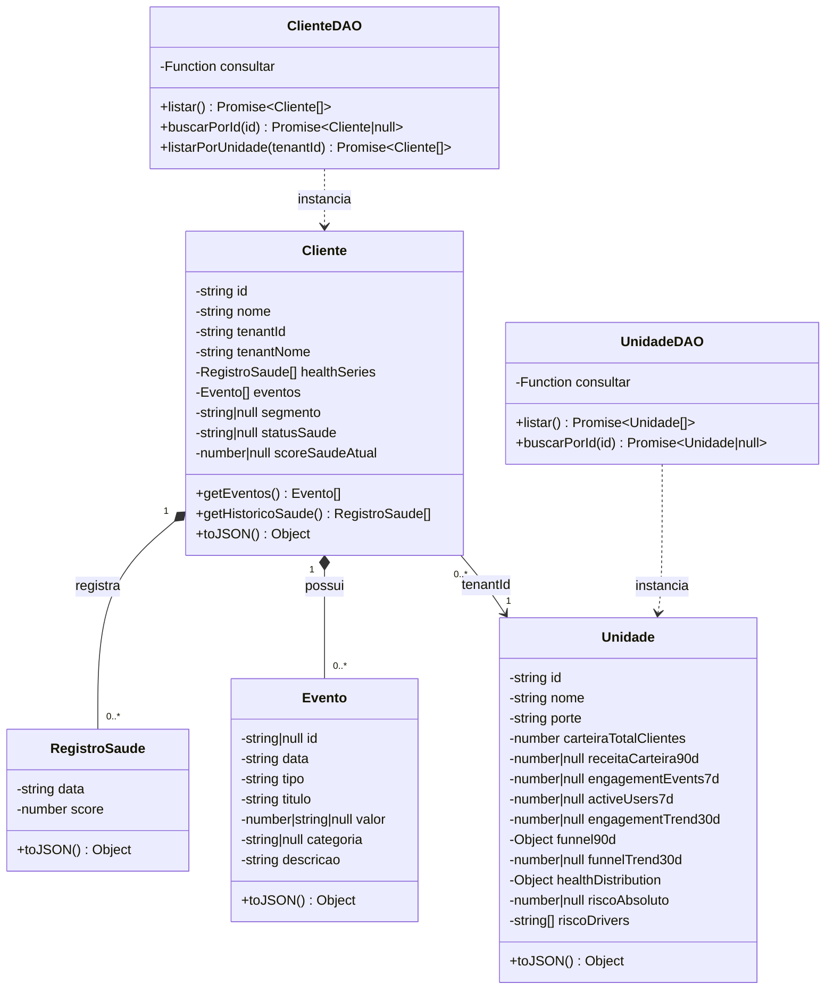

# Painel Vetor — Consulta e Gerenciamento de Unidades e Clientes (Primora / BFD)

> Projeto Integrador desenvolvido no programa **Bolsa Futuro Digital (BFD)** em parceria com a empresa **Primora Soluções em TI**, voltado à consulta e acompanhamento executivo de **unidades regionais (tenants)** e **clientes B2B** da **Distribuidora Vetor**.

---

## 1. Título e Apresentação do Projeto

O **Painel Vetor** é uma aplicação web de inteligência comercial e acompanhamento de carteira multi-tenant.

- **Empresa parceira:** Primora Soluções em TI
- **Domínio simulado:** Distribuidora Vetor (unidades regionais e contas B2B)
- **Problema:** Gestores precisam acompanhar indicadores de saúde da carteira, funil de conversão, engajamento e histórico de eventos de clientes distribuídos em diferentes unidades regionais, com filtros rápidos e leitura comparativa.
- **Solução:** Aplicação ReactJS + Ant Design organizada em camadas (`models`, `dao`, `config`, `pages`, `components`, `utils`), com consumo assíncrono via `GET` em API REST, encapsulamento de domínio com atributos privados (`#`) e três visões analíticas somente consulta: **Visão Executiva**, **Comparativo Regional** e **Jornada de Clientes**.

---

## 2. Deploy da Aplicação

| Recurso | Endereço | Situação |
| --- | --- | --- |
| **Frontend (aplicação web)** | *Não publicado publicamente nesta entrega* (há configuração pronta em [vercel.json](vercel.json) e [api/index.js](api/index.js) para deploy na Vercel) | Não publicado |
| **API REST — Unidades (n8n Produção)** | `https://n8n.incluc0de.com.br/webhook/primora/v1/unidades` | Publicado (`GET`) |
| **API REST — Clientes (n8n Produção)** | `https://n8n.incluc0de.com.br/webhook/primora/v1/clientes` | Publicado (`GET`) |
| **API Local de desenvolvimento (Express 5)** | `http://localhost:3001/api/v1` | Execução local |

---

## 3. Repositórios do Projeto

- **Repositório principal (Frontend, Modelos/DAOs e API local):** [https://github.com/MateusEstMendes/Desafio-Primora](https://github.com/MateusEstMendes/Desafio-Primora)

---

## 4. Visão Geral

- **Domínio:** Gestão e consulta multi-tenant de unidades regionais e contas B2B.
- **Entidades principais:**
  - `Unidade` (tenant regional: carteira total, saúde da carteira, funil de 90 dias, risco absoluto, drivers de risco e tendência).
  - `Cliente` (conta B2B vinculada a uma `Unidade` via `tenantId`).
  - `Evento` (marcos da jornada do cliente: reuniões, alertas, suporte, tarefas).
  - `RegistroSaude` (série histórica de pontuação de saúde `0..100` do cliente).
- **Objetivo:** Permitir a consulta consolidada e por unidade dos indicadores de carteira, o ranqueamento comparativo entre unidades e a inspeção detalhada da linha do tempo e score de cada cliente.
- **Origem e persistência dos dados:**
  - Os dados da aplicação são **simulados** e obtidos via consultas **somente leitura (`GET`)** na API REST (endpoints n8n de produção ou servidor Express local baseado em [server/data/dataset_painel_multitenant.json](server/data/dataset_painel_multitenant.json)).
  - **Não há persistência de escrita no backend** (`POST`, `PUT` ou `DELETE` não existem).
  - No navegador, apenas a preferência de tema (`light` / `dark`) é salva em `localStorage` (`color-scheme`).

---

## 5. Tecnologias Utilizadas

Comprovadas em [package.json](package.json):

- **React** `^18.3.1` e **React DOM** `^18.3.1`
- **Vite** `^6.2.0` (`@vitejs/plugin-react`)
- **Ant Design (`antd`)** `^5.24.2` e **@ant-design/icons** `^5.6.1`
- **Recharts** `^3.10.1` (gráficos de área, barras, linhas compostas e donut)
- **Motion** `^14.13.0` (transições e animações respeitando `reducedMotion`)
- **Day.js** `^1.11.13`
- **Express** `^5.3.0` e **CORS** `^2.8.6` (API local em `server/` e função serverless em `api/index.js`)
- **Node.js** `22.12+` (ES Modules e `node --test`)

---

## 6. Desafio Atendido

### Funcionalidades efetivamente implementadas
- Carregamento paralelo de unidades e clientes (`Promise.all` em [src/App.jsx](src/App.jsx)), exibindo estado de carregamento (`Spin`), tratamento de erro com botão **Tentar novamente** e estado vazio (`Empty`).
- Seletor global de escopo por unidade (`Todas as unidades` ou unidade específica) em [src/components/ScopeSelector.jsx](src/components/ScopeSelector.jsx).
- **Visão Executiva** ([src/pages/VisaoGeral.jsx](src/pages/VisaoGeral.jsx)): KPIs consolidados, distribuição de saúde da carteira, funil de 90 dias, taxa de conversão e séries de tendência.
- **Comparativo Regional** ([src/pages/Comparativo.jsx](src/pages/Comparativo.jsx)): ranking de criticidade, gráficos comparativos (composto, barras, donut de concentração por risco ou carteira) e cards expansíveis por unidade.
- **Jornada de Clientes** ([src/pages/HistoricoClientes.jsx](src/pages/HistoricoClientes.jsx)): diretório de clientes filtrável por unidade, evolução histórica do score de saúde e linha do tempo de eventos filtrável por categoria.
- Alternância entre **tema claro e escuro** persistida no navegador.

### Limitações conhecidas
- **Operações somente leitura (`GET`):** não existem rotas nem telas para criação (`POST`), edição (`PUT`/`PATCH`) ou exclusão (`DELETE`) de unidades ou clientes.
- **Dados simulados:** o dataset possui 4 unidades (`Sudeste`, `Sul`, `Nordeste`, `Centro-Oeste`) e 3 clientes (`CLI-001`, `CLI-002`, `CLI-003`); a unidade `Sul` não possui clientes diretos vinculados no dataset de exemplo.
- **Campos ausentes:** quando métricas como `receitaCarteira90d`, `engagementEvents7d` ou `activeUsers7d` não vêm no JSON, permanecem `null` sem estimativas artificiais.

---

## 7. Requisitos Funcionais (RF)

| Código | Requisito | Situação | Observação |
| --- | --- | --- | --- |
| **RF01** | Listar unidades regionais (tenants) via API REST (`GET`) | **Atendido** | Via `UnidadeDAO.listar()` |
| **RF02** | Listar clientes B2B e seus vínculos com unidades (`tenantId`) | **Atendido** | Via `ClienteDAO.listar()` e `listarPorUnidade(tenantId)` |
| **RF03** | Filtrar painéis e listas por unidade selecionada ou visão consolidada | **Atendido** | `ScopeSelector` propaga `selectedTenantId` às 3 abas |
| **RF04** | Exibir KPIs executivos, funil de 90 dias e distribuição de saúde | **Atendido** | Implementado em `VisaoGeral.jsx` |
| **RF05** | Comparar unidades por risco proporcional e volume de carteira | **Atendido** | Implementado em `Comparativo.jsx` |
| **RF06** | Exibir histórico de score de saúde e timeline de eventos do cliente | **Atendido** | Implementado em `HistoricoClientes.jsx` |
| **RF07** | Filtrar eventos da jornada do cliente por categoria | **Atendido** | Filtro por categoria em `HistoricoClientes.jsx` |
| **RF08** | Tratar falhas de rede/API e respostas vazias sem fallback silencioso | **Atendido** | `ErrorBoundary`, `Alert` com **Tentar novamente** e `Empty` |
| **RF09** | Operações de cadastro, edição ou exclusão (`POST`/`PUT`/`DELETE`) | **Não aplicável / Não implementado** | Escopo da API Primora (n8n) é exclusivamente `GET` |

---

## 8. Requisitos Não Funcionais (RNF)

| Código | Categoria | Descrição | Situação |
| --- | --- | --- | --- |
| **RNF01** | Arquitetura em camadas | Separação clara entre `config`, `dao`, `models`, `pages`, `components` e `utils` | **Atendido** |
| **RNF02** | Encapsulamento de domínio | Atributos privados (`#`), getters somente leitura e objetos congelados (`Object.freeze`) | **Atendido** |
| **RNF03** | Responsividade | Layout adaptativo para desktop e mobile via Ant Design `Grid.useBreakpoint()` e CSS dedicado | **Atendido** |
| **RNF04** | Usabilidade e acessibilidade | Tema claro/escuro, `pt_BR`, `aria-label` e suporte a `prefers-reduced-motion` | **Atendido** |
| **RNF05** | Integração HTTP padronizada | Cliente HTTP compartilhado validando URL base, status HTTP, JSON e formato array | **Atendido** |
| **RNF06** | Confiabilidade verificada | Suíte automatizada de métricas, domínio/DAO (77 verificações) e API (6 testes) | **Atendido** |

---

## 9. Telas da Aplicação

> **Nota sobre evidências:** abaixo estão as capturas atualmente armazenadas em [docs/imagens/](docs/imagens/). Recomenda-se complementar a pasta com capturas recentes de cada uma das 3 abas atuais (`Visão Executiva`, `Comparativo Regional` e `Jornada de Clientes`) antes da apresentação final.

| Visão Desktop (Mobile First em modo PC) | Visão Mobile |
| :---: | :---: |
|  |  |
| *Layout do painel em resolução desktop* | *Layout responsivo adaptado para dispositivos móveis* |

---

## 10. Modelagem dos Dados

As classes de domínio residem em [src/models/](src/models/index.js) e utilizam **campos privados (`#`)**, validação no construtor, normalização de aliases do dataset e serialização imutável via `toJSON()`.

- **`Unidade`** ([src/models/Unidade.js](src/models/Unidade.js)): representa a unidade regional (`id`, `nome`, `porte`, `carteiraTotalClientes`, `funnel90d`, `healthDistribution`, `riscoAbsoluto`, `riscoDrivers`, entre outros).
- **`Cliente`** ([src/models/Cliente.js](src/models/Cliente.js)): representa a conta B2B (`id`, `nome`, `tenantId`, `tenantNome`, `healthSeries`, `eventos`) e mantém vínculo lógico com `Unidade` através de `tenantId`. Fornece `getEventos()` e `getHistoricoSaude()` retornando cópias congeladas.
- **`Evento`** ([src/models/Evento.js](src/models/Evento.js)): representa cada registro da jornada do cliente (`data`, `tipo`, `titulo`, `valor` opcional, `id` opcional, `categoria`, `descricao`).
- **`RegistroSaude`** ([src/models/RegistroSaude.js](src/models/RegistroSaude.js)): representa cada ponto histórico de saúde (`data`/`periodo` e `score` validado entre `0` e `100`).

### Diagrama de Classes UML

- **Arquivo-fonte editável (PlantUML):** [docs/uml/diagrama-classes.puml](docs/uml/diagrama-classes.puml)



---

## 11. Integração com API REST

> **Importante:** Os dados retornados pela API são **simulados** e a integração disponível nos endpoints é **exclusivamente `GET`**. Não existem operações `POST`, `PUT` ou `DELETE`.

### Endpoints reais de produção (n8n — Primora)

| Recurso | Método | Endpoint | Descrição |
| --- | :---: | --- | --- |
| **Unidades** | `GET` | `https://n8n.incluc0de.com.br/webhook/primora/v1/unidades` | Retorna array JSON com as unidades/tenants e seus indicadores |
| **Clientes** | `GET` | `https://n8n.incluc0de.com.br/webhook/primora/v1/clientes` | Retorna array JSON com os clientes, histórico de saúde e eventos |

Para apontar o frontend para o ambiente n8n de produção, configure `VITE_API_BASE_URL=https://n8n.incluc0de.com.br/webhook/primora/v1` no `.env.local` (sem barra final). Para execução offline/local, o projeto também inclui um servidor Express equivalente em [server/](server/app.js) servindo `/api/v1/unidades` e `/api/v1/clientes`.

### Como os DAOs consomem, filtram e apresentam os dados

1. **Cliente HTTP ([src/config/api.js](src/config/api.js)):** `criarClienteHttp` valida `VITE_API_BASE_URL`, executa `fetch`, exige resposta `ok`, converte JSON e valida que o retorno é estritamente um `Array`. Em qualquer falha (rede, HTTP != 2xx, JSON inválido ou formato não-array), lança erro explícito sem usar fallback local.
2. **DAOs ([UnidadeDAO.js](src/dao/UnidadeDAO.js) e [ClienteDAO.js](src/dao/ClienteDAO.js)):**
   - `UnidadeDAO.listar()` consulta `GET /unidades` e mapeia cada item para `new Unidade(item)`. `buscarPorId(id)` retorna o modelo correspondente ou `null`.
   - `ClienteDAO.listar()` consulta `GET /clientes` e mapeia cada item para `new Cliente(item)`. `buscarPorId(id)` e `listarPorUnidade(tenantId)` filtram os registros em memória preservando o vínculo `tenantId`.
3. **Orquestração e filtros no Frontend ([src/App.jsx](src/App.jsx)):**
   - `App.jsx` executa `Promise.all([new UnidadeDAO().listar(), new ClienteDAO().listar()])`, descarta respostas obsoletas via flag de cleanup e converte os modelos com `.toJSON()` para consumo nas páginas.
   - Os filtros de unidade (`selectedTenantId`), ordenação de criticidade e filtragem de eventos por categoria ocorrem no frontend sobre os dados carregados, sem chamadas adicionais de escrita.

---

## 12. Estrutura do Projeto Frontend

```text
Desafio-Primora/
├── api/
│   └── index.js                 # Handler serverless (Vercel) da API local
├── docs/
│   ├── imagens/                 # Capturas de tela referenciadas no README
│   └── uml/
│       └── diagrama-classes.puml # Fonte editável do diagrama UML
├── public/                      # Logos estáticas da Primora
├── server/                      # Backend Express 5 local para testes/execução offline
│   ├── app.js
│   ├── dataset.js
│   ├── index.js
│   └── data/
│       └── dataset_painel_multitenant.json
├── src/
│   ├── components/              # TopBar, ScopeSelector, ClientDirectory, gráficos e CSS
│   ├── config/
│   │   └── api.js               # Cliente HTTP compartilhado (criarClienteHttp / consultarArray)
│   ├── dao/
│   │   ├── ClienteDAO.js
│   │   ├── UnidadeDAO.js
│   │   └── index.js
│   ├── models/
│   │   ├── Cliente.js
│   │   ├── Evento.js
│   │   ├── RegistroSaude.js
│   │   ├── Unidade.js
│   │   └── index.js
│   ├── pages/
│   │   ├── Comparativo.jsx
│   │   ├── HistoricoClientes.jsx
│   │   └── VisaoGeral.jsx
│   ├── utils/                   # Métricas matemáticas, tokens de tema e animações
│   ├── App.jsx                  # Carregamento paralelo, tema e roteamento entre abas
│   └── main.jsx
├── .env.example
├── package.json
├── test-api.js                  # Testes de contrato HTTP e erros (node --test)
├── test-metrics.js              # Testes de cálculos de risco e funil
├── test-sprint5.js              # 77 verificações de Models e DAOs
├── vercel.json
└── vite.config.js
```

---

## 13. Execução Local

### Pré-requisitos
- **Node.js** `22.12+` e **npm**

### Instalação
```bash
git clone https://github.com/MateusEstMendes/Desafio-Primora.git
cd Desafio-Primora
npm install
```

### Variáveis de ambiente
Copie [.env.example](.env.example) para `.env.local` e defina `VITE_API_BASE_URL` conforme o ambiente desejado:

- **Para usar a API n8n de produção (Primora):**
  ```env
  VITE_API_BASE_URL=https://n8n.incluc0de.com.br/webhook/primora/v1
  ```
- **Para usar a API local Express:**
  ```env
  VITE_API_BASE_URL=http://localhost:3001/api/v1
  PORT=3001
  CORS_ORIGINS=http://localhost:5173,http://127.0.0.1:5173
  ```

### Comandos para iniciar e verificar
```bash
# 1. (Opcional, se usar API local) Em um terminal, inicie o servidor Express:
npm run dev:server

# 2. Em outro terminal, inicie o frontend Vite:
npm run dev
```
Acesse `http://localhost:5173`.

```bash
# Executar todos os testes automatizados (métricas, domínio/DAO e API):
npm test

# Gerar build de produção:
npm run build
```

---

## 14. Autoria

- **Programa:** Bolsa Futuro Digital (BFD) — Projeto Integrador
- **Empresa parceira:** Primora Soluções em TI
- **Equipe (conforme histórico de commits do repositório):**
  - Mateus Estevam Silva Mendes (`MateusEstMendes`)
  - Felipe Saliba (`felipesaliba5-design`)
  - *(Adicionar demais integrantes, nome do curso e instituição de ensino caso aplicável)*

---

## 15. Considerações Finais

- **Resultados:** Foi entregue uma aplicação modular em ReactJS + Ant Design com separação em camadas (`config`, `dao`, `models`, `pages`), encapsulamento rigoroso de domínio e cobertura automatizada de testes (`test-metrics.js`, `test-sprint5.js` e `test-api.js`) e build Vite validados.
- **Dificuldades:** Alinhar contratos e aliases entre o dataset original, os endpoints REST (`GET`) e os componentes de visualização sem introduzir estimativas ou dados fictícios ausentes na fonte.
- **Limitações:** Aplicação estritamente de consulta (`GET`), com dataset simulado reduzido (4 unidades e 3 clientes) e sem publicação ativa do frontend em produção até o momento.
- **Possíveis melhorias:** Publicar o frontend na Vercel utilizando a configuração já preparada em [vercel.json](vercel.json), ampliar o volume de clientes por unidade, implementar paginação/filtros server-side e adicionar novas capturas de tela das 3 abas em [docs/imagens/](docs/imagens/).
