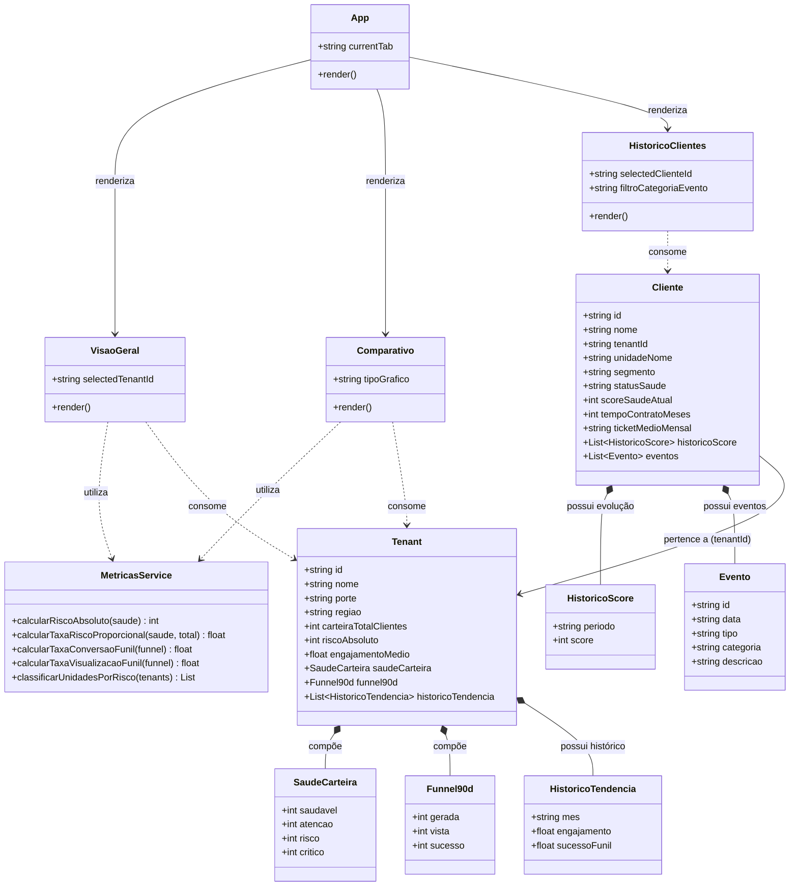

# Painel de Inteligência Multi-tenant — Distribuidora Vetor

> **Projeto Integrador — Bolsa Futuro Digital**  
> **Desafio 2:** Painel de Inteligência Multi-tenant em ReactJS e Ant Design (AntD)  
> **Status:** Protótipo Acadêmico Funcional com Dados Fictícios

---

## 📌 1. Visão Geral do Projeto

A **Distribuidora Vetor** opera em diferentes unidades regionais (*tenants*) que possuem carteiras de clientes de portes bastante variados. Este painel foi desenvolvido para atender às seguintes necessidades de negócio:

1. **Visão Gerencial Unificada:** Acompanhamento de indicadores de engajamento, funil comercial de tarefas e distribuição de saúde da carteira de clientes.
2. **Comparativo Justo entre Unidades:** Avaliação de desempenho e criticidade normalizada por porte, evitando a distorção gerada por comparações puramente absolutas.
3. **Acompanhamento da Jornada do Cliente:** Consulta cronológica de eventos com diferenciação visual e monitoramento da evolução do score de saúde.

---

## 🛠️ 2. Tecnologias Utilizadas

- **Framework:** [ReactJS](https://react.dev/) (v18) com [Vite](https://vitejs.dev/)
- **Biblioteca Visual (Obrigatória):** [Ant Design](https://ant.design/) (v5) e `@ant-design/icons`
- **Visualização de Dados (Gráficos):** [Recharts](https://recharts.org/)
- **Manipulação de Datas:** [Day.js](https://day.js.org/)
- **Fonte de Dados:** `dataset_painel_multitenant.json` local (conforme escopo acadêmico)

---

## 🚀 3. Instalação e Execução Local

### Pré-requisitos
- **Node.js** (versão 18 ou superior recomendada)
- **npm** (versão 9 ou superior)

### Passo a Passo

1. **Instalar dependências:**
   ```bash
   npm install
   ```

2. **Executar em ambiente de desenvolvimento:**
   ```bash
   npm run dev
   ```
   A aplicação estará acessível em: `http://localhost:5173`

3. **Gerar build de produção:**
   ```bash
   npm run build
   ```

---

## 📱 4. Descrição das Telas e Funcionalidades

### Tela 1 — Visão Geral (RF01, RF02, RF03, RF04, RF10, RF11)
- **Filtro de Unidade:** Permite alternar entre a visão de *Todas as Unidades (Consolidado)* ou selecionar uma unidade regional específica.
- **Cartões de Indicadores:** Total de clientes na carteira, taxa média de engajamento, clientes em risco/crítico e conversão final do funil.
- **Resumo das Quatro Unidades (RF01):** Cards interativos para cada tenant com nome, porte (Grande, Médio, Pequeno), clientes e taxa de conversão.
- **Funil Comercial de Tarefas (RF02):** Acompanhamento das etapas `Geradas` $\to$ `Visualizadas` $\to$ `Sucesso (Convertidas)`, com cálculo percentual transparente.
- **Distribuição de Saúde da Carteira (RF03):** Gráfico de pizza interativo e legendas detalhando as 4 categorias: *Saudável*, *Atenção*, *Risco* e *Crítico*.
- **Tendência Histórica (RF10):** Gráfico de linhas com evolução dos últimos 6 meses de engajamento e taxa de sucesso do funil.

### Tela 2 — Comparativo entre Unidades (RF05, RF06, RF09, RF12)
- **Tabela Comparativa Multidimensional:** Exibição das unidades com ordenação dinâmica (`sorters`) em todas as colunas numéricas e filtros por porte (`filters`).
- **Ranking de Criticidade (RF06):** Classificação automática baseada na taxa proporcional de risco, destacando as unidades mais vulneráveis.
- **Gráficos Comparativos (RF09):** Gráfico composto com eixos duplos mostrando lado a lado a discrepância entre escala absoluta (número de clientes) e taxa percentual de risco.

### Tela 3 — Histórico de Clientes (RF07, RF08, RF10, RF11)
- **Seletor de Clientes (RF07):** Seleção rápida dos clientes fictícios com identificação imediata de sua unidade vinculada.
- **Ficha do Cliente:** Dados cadastrais, segmento, tempo de contrato, ticket médio e score de saúde atual.
- **Evolução do Score de Saúde (RF10):** Gráfico de área demonstrando o histórico recente de pontuação de saúde.
- **Linha do Tempo de Eventos (RF08):** `Timeline` cronológica com diferenciação visual por cores e ícones para cada categoria (*Comercial*, *Operacional*, *Sucesso*, *Alerta*, *Crítico*), com data e descrição detalhada.

---

## 📐 5. Justificativas Teóricas e de UX

### 5.1 Critério do Indicador Comparativo Proporcional (RF05 & RF06)

* **Fórmula Adotada:**
  $$\text{Taxa de Risco Proporcional} = \frac{\text{Clientes em Risco} + \text{Clientes Críticos}}{\text{Carteira Total de Clientes}} \times 100$$
* **Por que normalizar por porte?**  
  Em valores absolutos, a **Unidade Sudeste (Matriz)** possui 100 clientes em risco (o maior número absoluto). Contudo, sobre uma base de 1.200 clientes, isso representa apenas **8,33%**. Por outro lado, a **Unidade Centro-Oeste** possui apenas 35 clientes em risco, mas sobre uma base de 150 clientes, isso representa **23,33%** da carteira. Sem normalização proporcional, a gestão focaria recursos na Matriz e ignoraria a fragilidade crítica do Centro-Oeste.
* **Limites da Fórmula:**  
  A fórmula adota pesos iguais para as categorias "Risco" e "Crítico" e não pondera a receita financeira (ticket médio) individual de cada contrato. Em uma evolução futura, recomenda-se ponderar pela receita sob risco.

### 5.2 Justificativa: Quando usar Gráfico vs. Tabela? (RF09)

| Formato | Quando é mais indicado | Exemplo no Painel |
| :--- | :--- | :--- |
| **Gráfico** | Ideal para identificar rapidamente contrastes de proporção, anomalias e tendências temporais sem sobrecarga cognitiva. | O gráfico composto da Tela 2 expõe de relance como o volume da Matriz mascara sua baixa taxa de risco proporcional. |
| **Tabela** | Essencial quando o usuário precisa consultar valores numéricos exatos, realizar comparações detalhadas, ordenar dados por colunas específicas e filtrar categorias. | A tabela comparativa da Tela 2 permite ordenar as unidades por qualquer indicador e filtrar por porte para auditoria. |

---

## 📂 6. Estrutura de Pastas do Código

```
proje/
├── index.html
├── package.json
├── vite.config.js
├── README.md
└── src/
    ├── main.jsx
    ├── App.jsx
    ├── data/
    │   └── dataset_painel_multitenant.json   # Dataset oficial com 4 tenants e 3 clientes
    ├── utils/
    │   └── metrics.js                        # Fórmulas de risco, funil e ranking
    ├── components/
    │   └── AcademicBanner.jsx                # Aviso de protótipo acadêmico
    └── pages/
        ├── VisaoGeral.jsx                    # Tela 1: Indicadores, Funil e Saúde
        ├── Comparativo.jsx                   # Tela 2: Tabela, Gráficos e Ranking
        └── HistoricoClientes.jsx             # Tela 3: Seleção, Timeline e Score
```

---

## 🏛️ 7. Diagrama de Classes UML

O diagrama abaixo modela a estrutura de dados (entidades e objetos de valor), a camada de regras de negócio (`MetricasService`) e a interação dos componentes visuais do painel:



---

## 📋 8. Matriz de Atendimento aos Requisitos

| Requisito | Descrição | Status | Onde verificar |
| :---: | :--- | :---: | :--- |
| **RF01** | Exibir as 4 unidades com nome e porte | ✅ Atendido | Tela 1 (Cards) e Tela 2 (Tabela/Gráfico) |
| **RF02** | Carteira, engajamento e funil comercial | ✅ Atendido | Tela 1 (Statistics e Funil de Tarefas) |
| **RF03** | Distribuição de saúde da carteira | ✅ Atendido | Tela 1 (Gráfico de Pizza e Legenda) |
| **RF04** | Selecionar/filtrar unidade | ✅ Atendido | Tela 1 (Select no topo) |
| **RF05** | Comparativo com indicador proporcional | ✅ Atendido | Tela 2 (Taxa de Risco Proporcional) |
| **RF06** | Ranking ordenado e cálculo explicado | ✅ Atendido | Tela 2 (Ranking e Card de Fundamentação) |
| **RF07** | Seleção de cliente e eventos cronológicos | ✅ Atendido | Tela 3 (Select e Timeline) |
| **RF08** | Diferenciação visual na timeline | ✅ Atendido | Tela 3 (Cores e ícones por tipo de evento) |
| **RF09** | Métrica em gráfico e tabela com justificativa | ✅ Atendido | Tela 2 (Tabela + Gráfico + Seção UX) |
| **RF10** | Tendência histórica de engajamento/funil/score | ✅ Atendido | Telas 1 e 3 (Gráficos temporais) |
| **RF11** | Tratamento de estados sem resultado | ✅ Atendido | Todas as telas (`Empty`, `Alert`) |
| **RF12** | Ordenar e filtrar tabela | ✅ Atendido | Tela 2 (Sorters e filtros por porte) |

---

*Distribuidora Vetor — Simulação Acadêmica para o Projeto Integrador (Bolsa Futuro Digital).*

