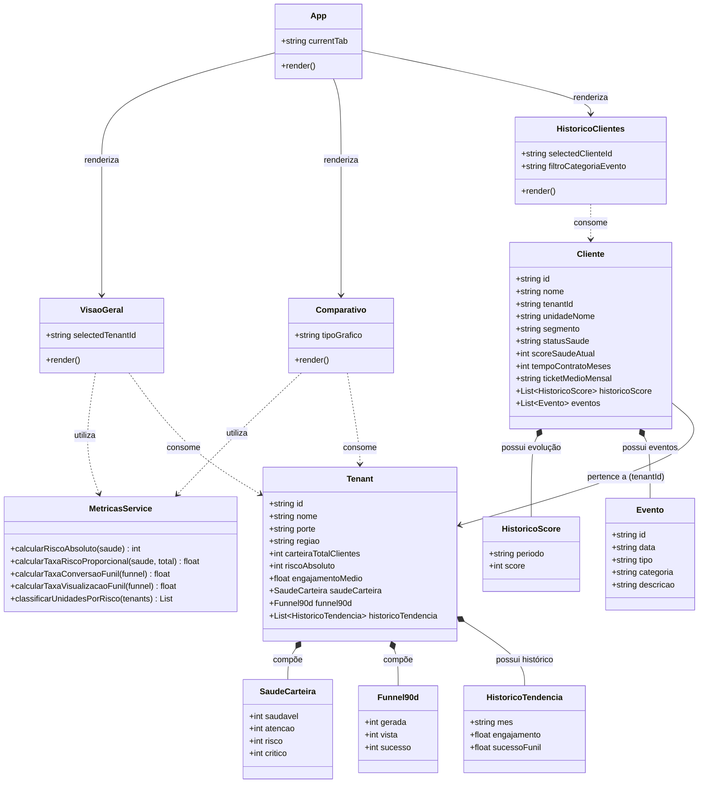

# Painel de Inteligência Multi-tenant — Distribuidora Vetor

> **Projeto Integrador — Bolsa Futuro Digital**  
> **Parceira:** PRIMORA | **Desafio:** Painel de Inteligência Multi-tenant  
> **Etapa:** Sprint 4 de 7 — Estados e Interatividade (`ReactJS`, `Vite` e `Ant Design`)  
> **Status:** Protótipo Acadêmico Funcional e Interativo com Dados do JSON Local

---

## 📌 1. Visão Geral do Projeto (Sprint 4: Estados e Interatividade)

A **Distribuidora Vetor** opera em diferentes unidades regionais (*tenants*) que possuem carteiras de clientes e operações distintas. Na **Sprint 4**, a aplicação evoluiu tornando interativos os componentes já construídos através do gerenciamento de estado (`useState`) e eventos (`onChange`), permitindo que as escolhas do usuário atualizem dinamicamente os dados exibidos **sem recarregar a página**.

### 🎯 Objetivos Centrais Atendidos na Sprint 4:
1. **Preservação e Continuidade:** Mantidas as três telas, o layout visual responsivo e a navegação da aplicação.
2. **Gerenciamento de Estado (`useState`):** Armazenamento das escolhas do usuário (unidade selecionada e cliente selecionado) no componente adequado.
3. **Controles Ant Design (`Select`):** Uso de componentes `<Select>` do Ant Design com eventos `onChange` funcionais tanto no computador quanto no celular.
4. **Atualização Dinâmica Reativa:** Ao alterar a seleção, os componentes correspondentes (cartões de indicadores, gráficos, detalhes do cliente e `Timeline`) recalculam e renderizam em tempo real.
5. **Fidelidade aos Dados:** Localização dos registros diretamente no `dataset_painel_multitenant.json` e transmissão via `props`, sem métricas inventadas.

---

## 🛠️ 2. Tecnologias Utilizadas

- **Framework:** [ReactJS](https://react.dev/) (v18) com [Vite](https://vitejs.dev/)
- **Biblioteca Visual (Obrigatória):** [Ant Design](https://ant.design/) (v5) e `@ant-design/icons`
- **Visualização de Dados (Gráficos):** [Recharts](https://recharts.org/)
- **Manipulação de Datas:** [Day.js](https://day.js.org/)
- **Fonte de Dados:** `dataset_painel_multitenant.json` local (conforme escopo acadêmico)

---

## 🚀 3. Instalação e Execução Local

### Pré-requisitos
- **Node.js** (versão 18 ou superior recomendada)
- **npm** (versão 9 ou superior)

### Passo a Passo

1. **Instalar dependências:**
   ```bash
   npm install
   ```

2. **Executar em ambiente de desenvolvimento:**
   ```bash
   npm run dev
   ```
   A aplicação estará acessível em: `http://localhost:5173`

3. **Executar os testes unitários de cálculo:**
   ```bash
   npm test
   ```

4. **Gerar build de produção:**
   ```bash
   npm run build
   ```

---

## 🎮 4. Guia Rápido de Demonstração das Interações (Sprint 4)

Para comprovar que as ações do usuário alteram o estado React e atualizam os dados renderizados sem recarregar a página, execute os seguintes passos:

### Interação 1 — Visão Geral (Seleção de Unidade Regional):
1. Acesse a aba **"Visão Executiva"**.
2. No cabeçalho da página (ou na barra superior), localize o componente **`<Select>` de Unidade Regional**.
3. Alterne entre as 4 unidades (`Unidade Sudeste`, `Unidade Sul`, `Unidade Nordeste`, `Unidade Centro-Oeste`) ou `Todas as unidades`.
4. **Resultado Imediato:** Os 4 cartões de indicadores executivos (*Exposição a Risco*, *Conversão do Funil*, *Engajamento Médio* e *Carteira Ativa*), bem como os gráficos de tendência e territórios, atualizam instantaneamente via props sem refresh.

### Interação 2 — Histórico de Clientes (Seleção de Cliente e Timeline):
1. Acesse a aba **"Jornada de Clientes"**.
2. No topo da tela, utilize o **`<Select>` do Ant Design** para escolher entre os clientes cadastrados (`CLI-001 - Supermercado Alvorada`, `CLI-002 - Atacado Horizonte`, `CLI-003 - Distribuidora Grão Nobre`).
3. **Resultado Imediato:** A identificação completa do cliente (código, razão social, regional vinculada, ticket médio, tempo de contrato e score) e a **`Timeline` de eventos cronológicos** se ajustam imediatamente com os eventos daquele cliente específico.

### Interação 3 — Comparativo entre Unidades (Tabela JSON Preservada):
1. Acesse a aba **"Comparativo Regional"**.
2. A tabela multidimensional alimentada pelo JSON exibe os dados de todas as 4 regionais com ordenação interativa e filtros por porte.

---

## 📱 5. Descrição Detalhada das Telas (Sprint 4)

### 🧩 Componentes React Reutilizáveis
- **`UnidadeCard.jsx` (Componente de Unidade com Props):**
  - Implementado para apresentar os cartões das quatro unidades do dataset (`Unidade Sudeste`, `Unidade Sul`, `Unidade Nordeste`, `Unidade Centro-Oeste`).
  - Recebe os dados da unidade via props (`unidade`, `isSelected`, `onSelect`, `themeTokens`).
  - Utiliza os componentes Ant Design: `<Card>`, `<Statistic>` (Carteira, Engajamento, Funil), `<Tag>` (Porte, Status de Risco, "Dado Fictício"), `<Typography>`, `<Row>` e `<Col>`.
  - Suporta seleção interativa com foco de teclado (`Enter`/`Espaço`) e navegação acessível.

### Tela 1 — Visão Geral (Sprint 2)
- **Cards de Indicadores Executivos (Ant Design):** Total de clientes na carteira, taxa proporcional de risco, conversão do funil de 90 dias e engajamento médio implementados com `<Card>`, `<Statistic>`, `<Tag>` e `<Row/Col>`.
- **Grade das Quatro Unidades Regionais:** Grid de `<Row gutter={[16, 16]}>` com os componentes reutilizáveis `<UnidadeCard />` apresentando nome, porte, carteira, engajamento e funil com dados estáticos do dataset.
- **Funil Comercial e Distribuição de Saúde:** Painel analítico de conversão com indicadores e gráficos informativos.
- **Identificação do Protótipo:** Banner e tags visuais indicando explicitamente dados estáticos e fictícios.

### Tela 2 — Comparativo entre Unidades (Sprint 2)
- **Tabela Comparativa Ant Design (`<Table>`):** Estrutura de tabela completa com unidades, carteira total, taxas ilustrativas, ordenação dinâmica (`sorters`) e filtros por porte.
- **Ranking de Criticidade e Espaço para Gráficos:** Classificação por criticidade e gráficos comparativos de barras e linha dupla ilustrando volumes absolutos vs. taxas proporcionais.

### Tela 3 — Histórico e Gestão de Clientes (CRUD Completo)
- **Operações de CRUD Integradas (Create, Read, Update, Delete):**
  - **Create (Adicionar):** Modal com formulário reativo para cadastrar novas contas B2B vinculadas a uma regional, com definição de segmento, tempo de contrato, ticket médio e score inicial.
  - **Read (Leitura):** Seletor em abas de todas as contas da carteira, ficha cadastral completa com ticket médio, tempo de contrato, variação semestral e gráfico de score.
  - **Update (Editar):** Modal de edição pré-populado para alterar dados cadastrais, porte, regional vinculada e score de saúde com registro automático de auditoria na timeline.
  - **Delete (Excluir):** Exclusão assistida com `<Popconfirm>` de confirmação do Ant Design, feedback imediato e seleção automática da próxima conta disponível.
- **Linha do Tempo Oficial Ant Design (`<Timeline>`):** Implementação via `<Timeline items={...} />` do Ant Design v5 com diferenciação visual por cores (`green`, `red`, `orange`, `cyan`) e ícones temáticos para cada categoria (*Sucesso*, *Crítico*, *Alerta*, *Comercial*), com data e descrição detalhada.
- **Persistência de Dados Local:** Armazenamento automático via `localStorage` garantindo que novos cadastros, edições e remoções permaneçam salvos entre recarregamentos de página.

---

## 📐 5. Justificativas Teóricas e de UX

### 5.1 Critério do Indicador Comparativo Proporcional (RF05 & RF06)

* **Fórmula Adotada:**
  $$\text{Taxa de Risco Proporcional} = \frac{\text{Clientes em Risco} + \text{Clientes Críticos}}{\text{Carteira Total de Clientes}} \times 100$$
* **Por que normalizar por porte?**  
  Em valores absolutos, a **Unidade Sudeste (Matriz)** possui 100 clientes em risco (o maior número absoluto). Contudo, sobre uma base de 1.200 clientes, isso representa apenas **8,33%**. Por outro lado, a **Unidade Centro-Oeste** possui apenas 35 clientes em risco, mas sobre uma base de 150 clientes, isso representa **23,33%** da carteira. Sem normalização proporcional, a gestão focaria recursos na Matriz e ignoraria a fragilidade crítica do Centro-Oeste.
* **Limites da Fórmula:**  
  A fórmula adota pesos iguais para as categorias "Risco" e "Crítico" e não pondera a receita financeira (ticket médio) individual de cada contrato. Em uma evolução futura, recomenda-se ponderar pela receita sob risco.

### 5.2 Justificativa: Quando usar Gráfico vs. Tabela? (RF09)

| Formato | Quando é mais indicado | Exemplo no Painel |
| :--- | :--- | :--- |
| **Gráfico** | Ideal para identificar rapidamente contrastes de proporção, anomalias e tendências temporais sem sobrecarga cognitiva. | O gráfico composto da Tela 2 expõe de relance como o volume da Matriz mascara sua baixa taxa de risco proporcional. |
| **Tabela** | Essencial quando o usuário precisa consultar valores numéricos exatos, realizar comparações detalhadas, ordenar dados por colunas específicas e filtrar categorias. | A tabela comparativa da Tela 2 permite ordenar as unidades por qualquer indicador e filtrar por porte para auditoria. |

---

## 📂 6. Estrutura de Pastas do Código

```
Desafio-Primora/
├── index.html
├── package.json
├── vite.config.js
├── test-metrics.js                           # Suite de testes de validação das fórmulas
├── README.md
└── src/
    ├── main.jsx                              # Ponto de entrada React 18
    ├── App.jsx                               # Shell da aplicação com ConfigProvider Ant Design
    ├── data/
    │   └── dataset_painel_multitenant.json   # Dataset oficial com 4 tenants e 3 clientes
    ├── utils/
    │   ├── metrics.js                        # Funções de cálculo estatístico e formatação
    │   └── themeTokens.js                    # Design tokens Dark/Light e semântica de risco
    ├── components/
    │   ├── UnidadeCard.jsx                   # Componente reutilizável com AntD Card, Statistic e Tag
    │   ├── TopBar.jsx                        # Barra de navegação entre as 3 telas e alternador de tema
    │   ├── AcademicBanner.jsx                # Banner identificador de protótipo acadêmico
    │   ├── FlatFunnelHealth.jsx              # Componente de funil e saúde da carteira
    │   └── componentsCSS/                    # Folhas de estilo modularizadas
    └── pages/
        ├── VisaoGeral.jsx                    # Tela 1: Indicadores consolidados e Grid de UnidadeCard
        ├── Comparativo.jsx                   # Tela 2: Tabela Ant Design e Gráficos Comparativos
        └── HistoricoClientes.jsx             # Tela 3: Ficha de Cliente e Timeline Ant Design
```

---

## 🏛️ 7. Diagrama de Classes UML

O diagrama abaixo modela a estrutura de dados (entidades e objetos de valor), a camada de regras de negócio (`MetricasService`) e a interação dos componentes visuais do painel:



---

## 📋 8. Matriz de Atendimento aos Requisitos

| Requisito | Descrição | Status | Onde verificar |
| :---: | :--- | :---: | :--- |
| **RF01** | Exibir as 4 unidades com nome e porte | ✅ Atendido | Tela 1 (Cards) e Tela 2 (Tabela/Gráfico) |
| **RF02** | Carteira, engajamento e funil comercial | ✅ Atendido | Tela 1 (Statistics e Funil de Tarefas) |
| **RF03** | Distribuição de saúde da carteira | ✅ Atendido | Tela 1 (Gráfico de Pizza e Legenda) |
| **RF04** | Selecionar/filtrar unidade | ✅ Atendido | Tela 1 (Select no topo) |
| **RF05** | Comparativo com indicador proporcional | ✅ Atendido | Tela 2 (Taxa de Risco Proporcional) |
| **RF06** | Ranking ordenado e cálculo explicado | ✅ Atendido | Tela 2 (Ranking e Card de Fundamentação) |
| **RF07** | Seleção de cliente e eventos cronológicos | ✅ Atendido | Tela 3 (Select e Timeline) |
| **RF08** | Diferenciação visual na timeline | ✅ Atendido | Tela 3 (Cores e ícones por tipo de evento) |
| **RF09** | Métrica em gráfico e tabela com justificativa | ✅ Atendido | Tela 2 (Tabela + Gráfico + Seção UX) |
| **RF10** | Tendência histórica de engajamento/funil/score | ✅ Atendido | Telas 1 e 3 (Gráficos temporais) |
| **RF11** | Tratamento de estados sem resultado | ✅ Atendido | Todas as telas (`Empty`, `Alert`) |
| **RF12** | Ordenar e filtrar tabela | ✅ Atendido | Tela 2 (Sorters e filtros por porte) |

---

*Distribuidora Vetor — Simulação Acadêmica para o Projeto Integrador (Bolsa Futuro Digital).*
